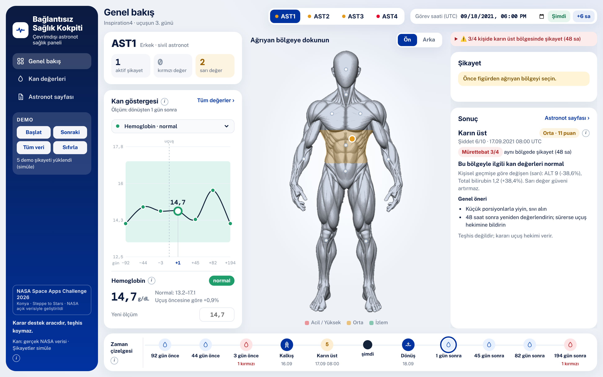

# Bağlantısız Sağlık Kokpiti

> **NASA Space Apps Challenge 2026, Konya · Takım: Steppe to Stars**  
> Dünya ile bağlantının geciktiği ya da koptuğu anlarda astronotun belirtilerini ve kan değerlerini çevrimdışı izleyip aciliyeti değerlendiren, tek dosyalık tarayıcı uygulaması.

### 🔗 Canlı demo: **https://suedakurnaz.github.io/baglantisiz-saglik-kokpiti/**

> [!NOTE]
> Uygulama tamamen çevrimdışı çalışır: veri, gösterge tablosu ve fontlar tek HTML dosyasının içindedir. Yalnızca NASA'nın açık verisi (Inspiration4 — OSD-569 / OSD-575) kullanılmıştır. Karar destek aracıdır, teşhis koymaz.



---

## Problem

Mars yörüngesinde tek yönlü sinyal gecikmesi 20 dakikaya kadar çıkar; bağlantı tümüyle de kesilebilir. Bu sırada mürettebatın yanında Dünya'daki hekim yoktur. Kokpit, o boşlukta astronotun kendi verisiyle "bu ne kadar acil?" sorusuna yanıt vermeyi hedefler.

## Neler var

- **Genel bakış** — ağrıyan bölgeye insan figürü üzerinden dokunarak şikâyet girme (ön / arka)
- **Aciliyet değerlendirmesi** — şikâyet ve kan değerlerinden *Acil / Yüksek · Orta · İzlem* sonucu
- **Kan değerleri** — CBC ve CMP göstergeleri, normal aralığa göre konum ve uçuş öncesine göre değişim
- **Zaman çizelgesi** — uçuş öncesi, kalkış, dönüş ve sonrasındaki ölçümler arasında gezinme
- **Astronot sayfası** — dört astronotun (AST1–AST4) ayrı profilleri
- **Demo kontrolleri** — örnek veriyle başlatma, sıfırlama, tüm veriyi gösterme

## Hızlı başlangıç

| Yol | Nasıl |
| --- | --- |
| **Tarayıcıda** | [Canlı demoyu](https://suedakurnaz.github.io/baglantisiz-saglik-kokpiti/) aç |
| **Çevrimdışı** | `uygulama/Baglantisiz_Saglik_Kokpiti_v5.html` dosyasını indirip tarayıcıda aç — internet gerekmez |

## Klasörler

| Klasör | İçerik |
| --- | --- |
| `uygulama/` | Çalışan uygulama (son sürüm v5) |
| `ekran_goruntuleri/` | Son sürümün ekran görüntüleri |
| `sunum/` | Jüri sunumu (.pptx) |
| `dokumanlar/` | Proje dokümanı, "yalnızca NASA verisi" kuralı, karar notları |
| `arastirma_raporlari/` | 8 araştırma raporu (R1–R8) |
| `kaynak/` | Uygulamanın kaynak dosyaları ve derleme betikleri |
| `veri/` | Birleşik NASA kan verisi, ham NASA CSV'leri ve metadata |

Ayrıntılı dosya açıklamaları için [OKUBENI.txt](OKUBENI.txt).

## Yeniden derleme

```bash
python3 kaynak/donustur.py   # NASA CSV'leri → veri/inspiration4_kan.json
python3 kaynak/build.py      # parçalar → uygulama/...v4.html
```

> [!WARNING]
> `kaynak/` kodu 15.11 sürümüdür (Astronot sayfası yok). Güncel uygulama `uygulama/` altındaki **v5**'tir.

## Veri kaynakları

- NASA OSDR **OSD-569** — Inspiration4 tam kan sayımı (CBC)
- NASA OSDR **OSD-575** — Inspiration4 kapsamlı metabolik panel (CMP)

Fontlar (Inter, Public Sans, DM Mono) SIL Open Font License kapsamındadır.

## Ekip

**Steppe to Stars** — NASA Space Apps Challenge 2026, Konya
